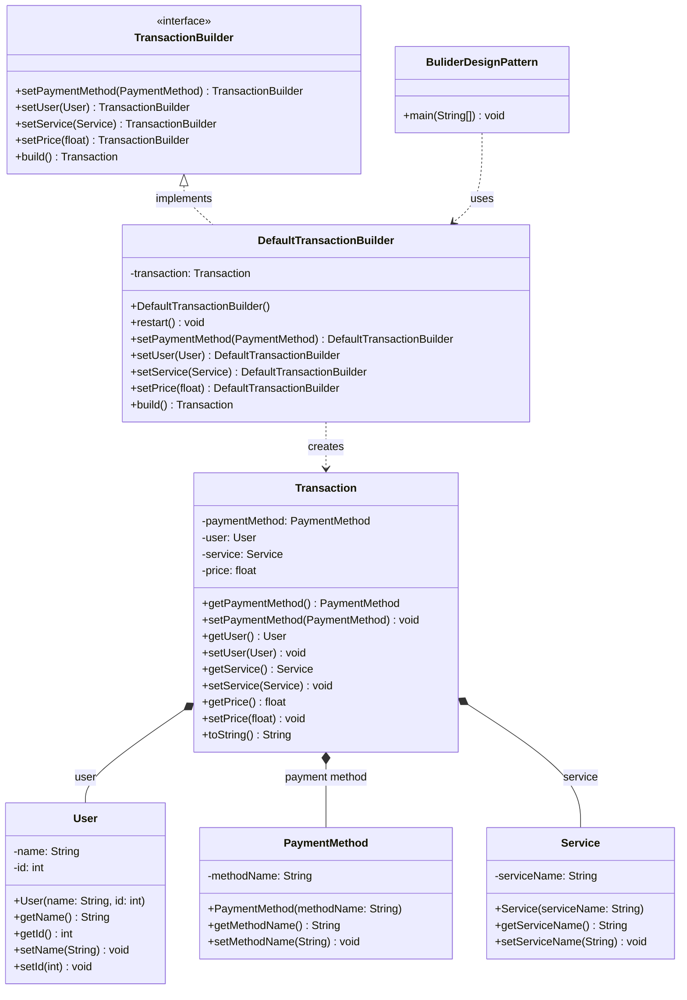

# UML Class Diagram

`Transaction *-- User`, `PaymentMethod`, and `Service` show that `Transaction` holds references to these objects. They are associations in the code; the filled diamonds are used here to show the transaction's conceptual ownership of those fields.
