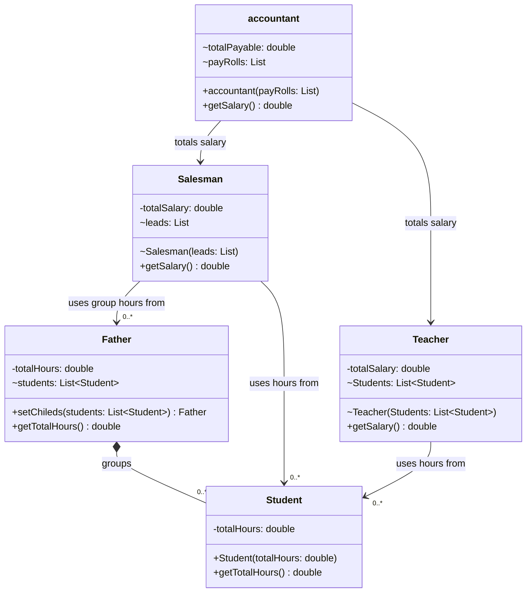

# Project UML and Business Model

## UML class diagram

This simplified diagram omits the interface types and focuses on the concrete classes. `Student` provides hours, and `Father` groups students and sums their hours. `Salesman` calculates pay from students or father groups; `Teacher` calculates pay from students. The accountant totals the salaries of payroll objects. In the Java code, the lists are typed with interfaces (`ILead` and `IPayRoll`); the diagram leaves those list types generic to keep the interfaces out of the view.

In the diagram, `~` means package-private visibility, `+` means public, and `-` means private.

## Business model

- A `Student` contributes its configured number of hours.
- A `Father` groups students and reports their combined hours.
- `Salesman` and `Teacher` calculate pay at 100 currency units per hour.
- `accountant` totals the salary of a list of payroll objects.
- The sample data totals 100 hours for the salesman (10,000) and 110 hours for the teacher (11,000), for a total payable amount of **21,000**.

The currency and the meaning of these roles are not specified in the code, so the amounts and descriptions above reflect only the implemented calculations.
