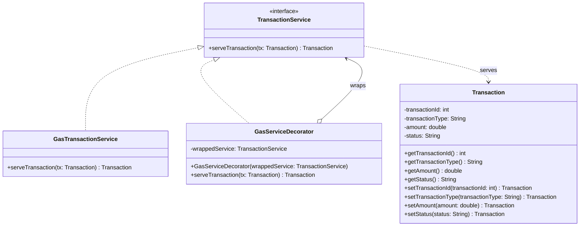

# Decorator Pattern UML

`GasServiceDecorator` implements the same `TransactionService` interface as the concrete service and holds a `TransactionService` reference. This lets it add behavior around the wrapped service call.
