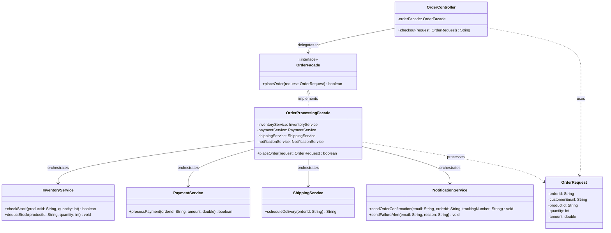

# Facade Pattern in MVC UML

### Architectural Role in MVC
1. **Controller (Thin Controller)**: Only handles HTTP request parsing, basic validation, and HTTP response mapping.
2. **Facade Service (OrderProcessingFacade)**: Serves as a single unified entry point that orchestrates complex business interactions among multiple independent subsystem services (`InventoryService`, `PaymentService`, `ShippingService`, `NotificationService`).
3. **Subsystems**: Independent services focusing only on their domain logic, unaware of the Facade or the Controller.
